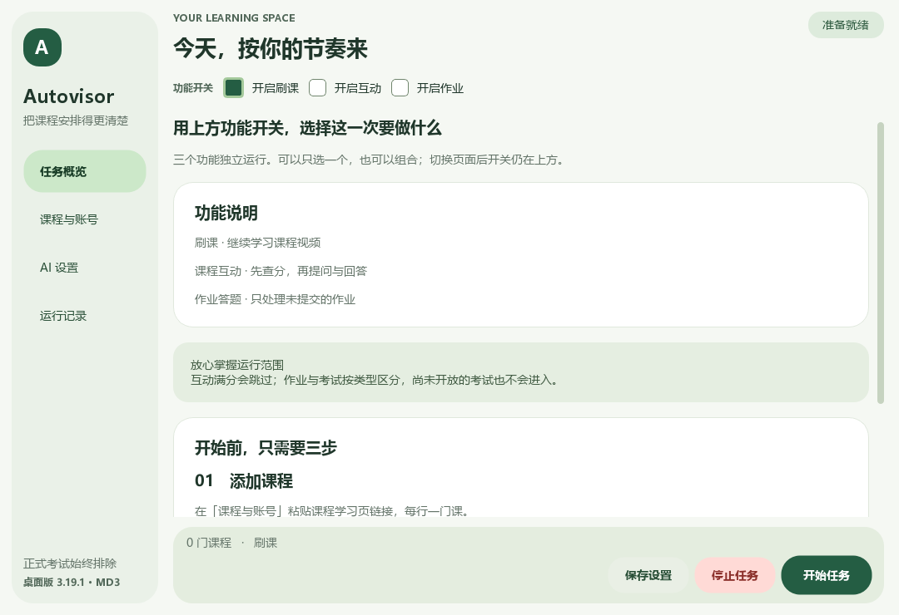

# Autovisor 课程助手

二改自 [CXRunfree/Autovisor](https://github.com/CXRunfree/Autovisor) ，并同时遵从MIT协议。

增加了刷互动分与答题功能，因此**需要接入AI。**

一个可以直接打开使用的 Windows 桌面软件，支持智慧树（知到）课程的**视频学习、课程互动和作业答题**。

界面采用 Material Design 3 风格。**不处理正式考试，~~因为我现在没有实际使用场景。~~**

## 第一次使用

### 1. 下载并解压

到 [下载页面](https://github.com/qazedc-abcd/Autovisor/releases/latest)，下载名称以 `windows-amd64.zip` 结尾的文件。

右键压缩包，选择“全部解压”，打开解压后的 Autovisor 文件夹，**双击 Autovisor.exe**。

无需安装 Python。请使用 Windows 10/11 64 位，并确保电脑已经安装 Microsoft Edge 或 Google Chrome。

不要直接在压缩包里运行，也不要只把一个 EXE 拖到桌面。主程序需要旁边的工作程序和文件夹一起运行。想放到桌面，可以创建快捷方式。

### 2. 添加课程

打开软件左侧的“课程与账号”。

1. 在浏览器中登录智慧树，进入要学习的课程。
2. 打开该课程的视频学习页面。
3. 复制地址栏中的**完整链接**，粘贴到软件的“课程链接”。
4. 多门课分行填写，一行一门课。

链接通常以 `https://studyvideoh5.zhihuishu.com/` 开头。不要填写学生首页或考试页的链接。

账号和密码可以留空，开始后在弹出的浏览器里自己登录即可。默认使用 Edge；如果使用 Chrome，可以在这里切换。浏览器路径通常不用填写。

### 3. 选择运行功能

回到“任务概览”，点击功能卡片。绿色表示开启，再点一下可以关闭。

|功能|会做什么|需要 AI 密钥吗|
|---|---|---|
|刷课|继续学习课程视频|不需要|
|课程互动|先查分，再按设置数量提问、回答|需要|
|作业答题|处理明确标记为作业、尚未提交的内容|需要|

可以只选一个，也可以组合开启。关闭刷课后不会打开视频页或启动视频任务。**正式考试始终排除，包括将来开放的考试。**

### 4. 按需填写 AI 密钥

如果开启互动或作业，请到“AI 设置”填写从 AI 服务商获得的 API 密钥。软件没有附赠或共享密钥。

建议使用DeepSeek的api，够聪明，够便宜，在这里注册并获取api密钥[DeepSeek开放平台](https://platform.deepseek.com)

|设置|默认值|
|---|---|
|服务地址|`https://api.deepseek.com`|
|模型名称|`deepseek-flash`|
|请求超时|60 秒|
|最大重试次数|2 次|

使用其他 OpenAI 兼容服务时，按服务商说明修改地址和模型。AI 服务可能收费，由你的服务商计费。图片题干需要模型支持图片输入。只刷视频时不用填写 AI。

互动的提问、回答数量可分别调整，填 0 即关闭对应能力。数量也作为每门课当天的上限。

### 5. 开始任务

点击“保存设置”，再点击“开始任务”。软件会切到“运行记录”显示当前进度。

浏览器打开后按提示完成登录。遇到需要操作的安全验证，切到浏览器手动完成，程序会等待。

结束时点击“停止任务”。请尽量避免在网站正在保存或提交作业时强制结束。

## 关于互动和作业

- 互动先检查该课程的实际得分，满分就跳过，不会固定按 5 分判断。读不到有效得分时不会发布。
- 得分通常次日更新，软件会记录当天已发布的内容，避免重复发布。
- **作业会实际填写、保存并提交。** 开启前请确认你希望这样执行。支持单选、多选、判断题；不支持的题型会停止并提示。
- **AI 可能答错。** 请以平台显示的提交状态和成绩为准，不保证满分。
- 当前主要适配已有共享课页面。网站改版或其他类型课程可能需要进一步适配。

## 常见问题

### 提示缺少文件或启动失败

重新完整解压发行包。请保留 AutovisorWorker.exe、internal、engine、resources 等随附文件，不要只复制主程序。

### 浏览器打不开

确认安装了 Edge 或 Chrome，并在“课程与账号”里选对浏览器。默认启动失败时，再填写对应浏览器程序的完整路径。

### AI 鉴权失败或请求失败

检查密钥、账户额度、服务地址和模型名称。服务不支持图片输入时，部分题干无法识别。

### 作业提示停止，软件却还在运行

软件可能继续处理其他已选任务。查看“运行记录”中的题号或加载错误，不要仅凭窗口还在运行就认为作业已经成功。

### 互动发完了，得分为什么没变

得分通常不是实时更新的。次日再查看“成绩分析 → 我的互动 → 我的得分”，不要为了即时涨分反复运行。

### 设置在哪里？

所有设置都在软件旁边的 config.ini，平时直接在界面里修改，不需要编辑代码。

data 保存登录状态，.autovisor 保存互动记录和答案缓存，logs 保存日志。不要把自己使用后的 config.ini、data、.autovisor 或日志公开上传、提交到 GitHub或发给陌生人，其中可能包含密钥、登录信息和课程记录。

### 怎么反馈问题？

点击“运行记录 → 打开日志文件夹”，找到最近的日志。发给别人前删除账号、密钥和私密课程信息，并说明选择了哪些功能、在哪一步停止。并上传到[Issues](https://github.com/qazedc-abcd/Autovisor/issues)中

## 开发者入口

普通用户不需要执行命令。源码运行、测试和打包方法见 [开发说明](docs/DEVELOPMENT.md)。

本项目基于 [CXRunfree/Autovisor](https://github.com/CXRunfree/Autovisor) 修改，保留原项目 MIT 许可证和版权。第三方组件见 [THIRD_PARTY_NOTICES.md](THIRD_PARTY_NOTICES.md)。
